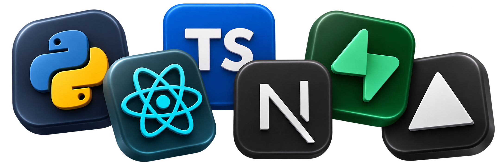

<!-- GitHub profile README for github.com/PurpleCowD -->

  <h1>Hi, I'm Simón Paipa</h1>
  
<em>Turning ideas into software people can use.</em>

  
<a href="https://github.com/PurpleCowD/PurpleCowD/blob/main/assets/simon-paipa-cv.pdf">View my CV ↗</a>

---

## About me

I build software that connects algorithms with usable interfaces. My collaborative projects include implementing graph-search algorithms in Python, developing perception-based decision logic for an intelligent agent, and integrating Spanish speech recognition into a browser-based 3D game.

I have also designed interactive interfaces for visualizing neural-network training and developed the frontend of a tournament platform used in live competition. I enjoy making complex behavior easier to explore, understand, and use.

## Technologies & tools

### Primary stack

  

Python · TypeScript · React · Next.js · Supabase · Vercel

### Other tools I use

  

JavaScript · HTML5 · CSS3 · Tailwind CSS · Git · GitHub · VS Code

## Your move.

One board. Everyone plays. Make a move and leave the next one to another visitor.

<!-- CHESS:START -->
**Game 1 · Black to move**

<table>
<tr>
<td valign="top" width="60%">

</td>
<td valign="top" width="40%">
<h3>Choose your move</h3>

Select a destination, then submit the prefilled issue. Anyone with a GitHub account can play either side.

<table>
<tr><th>From</th><th>Move</th></tr>
<tr><td>a7</td><td><a href="https://github.com/PurpleCowD/PurpleCowD/issues/new?title=chess%3A+1%3A1%3Aa7a5&amp;body=Submit+this+issue+to+play+your+move.+The+board+updates+automatically%3B+refresh+the+profile+afterwards.">a5</a> · <a href="https://github.com/PurpleCowD/PurpleCowD/issues/new?title=chess%3A+1%3A1%3Aa7a6&amp;body=Submit+this+issue+to+play+your+move.+The+board+updates+automatically%3B+refresh+the+profile+afterwards.">a6</a></td></tr>
<tr><td>b7</td><td><a href="https://github.com/PurpleCowD/PurpleCowD/issues/new?title=chess%3A+1%3A1%3Ab7b5&amp;body=Submit+this+issue+to+play+your+move.+The+board+updates+automatically%3B+refresh+the+profile+afterwards.">b5</a> · <a href="https://github.com/PurpleCowD/PurpleCowD/issues/new?title=chess%3A+1%3A1%3Ab7b6&amp;body=Submit+this+issue+to+play+your+move.+The+board+updates+automatically%3B+refresh+the+profile+afterwards.">b6</a></td></tr>
<tr><td>b8</td><td><a href="https://github.com/PurpleCowD/PurpleCowD/issues/new?title=chess%3A+1%3A1%3Ab8a6&amp;body=Submit+this+issue+to+play+your+move.+The+board+updates+automatically%3B+refresh+the+profile+afterwards.">Na6</a> · <a href="https://github.com/PurpleCowD/PurpleCowD/issues/new?title=chess%3A+1%3A1%3Ab8c6&amp;body=Submit+this+issue+to+play+your+move.+The+board+updates+automatically%3B+refresh+the+profile+afterwards.">Nc6</a></td></tr>
<tr><td>c7</td><td><a href="https://github.com/PurpleCowD/PurpleCowD/issues/new?title=chess%3A+1%3A1%3Ac7c5&amp;body=Submit+this+issue+to+play+your+move.+The+board+updates+automatically%3B+refresh+the+profile+afterwards.">c5</a> · <a href="https://github.com/PurpleCowD/PurpleCowD/issues/new?title=chess%3A+1%3A1%3Ac7c6&amp;body=Submit+this+issue+to+play+your+move.+The+board+updates+automatically%3B+refresh+the+profile+afterwards.">c6</a></td></tr>
<tr><td>d7</td><td><a href="https://github.com/PurpleCowD/PurpleCowD/issues/new?title=chess%3A+1%3A1%3Ad7d5&amp;body=Submit+this+issue+to+play+your+move.+The+board+updates+automatically%3B+refresh+the+profile+afterwards.">d5</a> · <a href="https://github.com/PurpleCowD/PurpleCowD/issues/new?title=chess%3A+1%3A1%3Ad7d6&amp;body=Submit+this+issue+to+play+your+move.+The+board+updates+automatically%3B+refresh+the+profile+afterwards.">d6</a></td></tr>
<tr><td>e7</td><td><a href="https://github.com/PurpleCowD/PurpleCowD/issues/new?title=chess%3A+1%3A1%3Ae7e5&amp;body=Submit+this+issue+to+play+your+move.+The+board+updates+automatically%3B+refresh+the+profile+afterwards.">e5</a> · <a href="https://github.com/PurpleCowD/PurpleCowD/issues/new?title=chess%3A+1%3A1%3Ae7e6&amp;body=Submit+this+issue+to+play+your+move.+The+board+updates+automatically%3B+refresh+the+profile+afterwards.">e6</a></td></tr>
<tr><td>f7</td><td><a href="https://github.com/PurpleCowD/PurpleCowD/issues/new?title=chess%3A+1%3A1%3Af7f5&amp;body=Submit+this+issue+to+play+your+move.+The+board+updates+automatically%3B+refresh+the+profile+afterwards.">f5</a> · <a href="https://github.com/PurpleCowD/PurpleCowD/issues/new?title=chess%3A+1%3A1%3Af7f6&amp;body=Submit+this+issue+to+play+your+move.+The+board+updates+automatically%3B+refresh+the+profile+afterwards.">f6</a></td></tr>
<tr><td>g7</td><td><a href="https://github.com/PurpleCowD/PurpleCowD/issues/new?title=chess%3A+1%3A1%3Ag7g5&amp;body=Submit+this+issue+to+play+your+move.+The+board+updates+automatically%3B+refresh+the+profile+afterwards.">g5</a> · <a href="https://github.com/PurpleCowD/PurpleCowD/issues/new?title=chess%3A+1%3A1%3Ag7g6&amp;body=Submit+this+issue+to+play+your+move.+The+board+updates+automatically%3B+refresh+the+profile+afterwards.">g6</a></td></tr>
<tr><td>g8</td><td><a href="https://github.com/PurpleCowD/PurpleCowD/issues/new?title=chess%3A+1%3A1%3Ag8f6&amp;body=Submit+this+issue+to+play+your+move.+The+board+updates+automatically%3B+refresh+the+profile+afterwards.">Nf6</a> · <a href="https://github.com/PurpleCowD/PurpleCowD/issues/new?title=chess%3A+1%3A1%3Ag8h6&amp;body=Submit+this+issue+to+play+your+move.+The+board+updates+automatically%3B+refresh+the+profile+afterwards.">Nh6</a></td></tr>
<tr><td>h7</td><td><a href="https://github.com/PurpleCowD/PurpleCowD/issues/new?title=chess%3A+1%3A1%3Ah7h5&amp;body=Submit+this+issue+to+play+your+move.+The+board+updates+automatically%3B+refresh+the+profile+afterwards.">h5</a> · <a href="https://github.com/PurpleCowD/PurpleCowD/issues/new?title=chess%3A+1%3A1%3Ah7h6&amp;body=Submit+this+issue+to+play+your+move.+The+board+updates+automatically%3B+refresh+the+profile+afterwards.">h6</a></td></tr>
</table>
</td>
</tr>
</table>

Recent moves

| Move | Player |
| :--- | :--- |
| c3 | [PurpleCowD](https://github.com/PurpleCowD) |

<!-- CHESS:END -->

Inspired by [Tim Burgan’s community chess](https://github.com/timburgan/timburgan). Rules validated with [python-chess](https://python-chess.readthedocs.io/).

---

  
<em>Thanks for stopping by—and for making your move.</em>

  © 2026 Simón Paipa. Original profile content.

