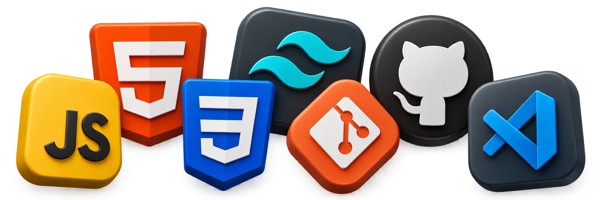

<!-- GitHub profile README for github.com/PurpleCowD -->

  
  

---

## About me

I explore how intelligent systems can become useful, intuitive experiences—from neural networks and search algorithms to voice interfaces and web applications. At Universidad Militar Nueva Granada, I bring together software development, artificial intelligence, and interaction design.

## Technologies & tools

### Primary stack

  

Python · TypeScript · React · Next.js · Supabase · Vercel

### Other tools I use

  

JavaScript · HTML5 · CSS3 · Tailwind CSS · Git · GitHub · VS Code

## Your move.

One board. Everyone plays. Make a move and leave the next one to another visitor.

<!-- CHESS:START -->
**Game 1 · White to move**

Choose a move below, then submit the prefilled GitHub issue. Anyone with a GitHub account can play either side.

| Piece from | Legal destinations |
| :--- | :--- |
| a2 | [a3](https://github.com/PurpleCowD/PurpleCowD/issues/new?title=chess%3A+1%3A0%3Aa2a3&body=Submit+this+issue+to+play+your+move.+The+board+updates+automatically%3B+refresh+the+profile+afterwards.) · [a4](https://github.com/PurpleCowD/PurpleCowD/issues/new?title=chess%3A+1%3A0%3Aa2a4&body=Submit+this+issue+to+play+your+move.+The+board+updates+automatically%3B+refresh+the+profile+afterwards.) |
| b1 | [Na3](https://github.com/PurpleCowD/PurpleCowD/issues/new?title=chess%3A+1%3A0%3Ab1a3&body=Submit+this+issue+to+play+your+move.+The+board+updates+automatically%3B+refresh+the+profile+afterwards.) · [Nc3](https://github.com/PurpleCowD/PurpleCowD/issues/new?title=chess%3A+1%3A0%3Ab1c3&body=Submit+this+issue+to+play+your+move.+The+board+updates+automatically%3B+refresh+the+profile+afterwards.) |
| b2 | [b3](https://github.com/PurpleCowD/PurpleCowD/issues/new?title=chess%3A+1%3A0%3Ab2b3&body=Submit+this+issue+to+play+your+move.+The+board+updates+automatically%3B+refresh+the+profile+afterwards.) · [b4](https://github.com/PurpleCowD/PurpleCowD/issues/new?title=chess%3A+1%3A0%3Ab2b4&body=Submit+this+issue+to+play+your+move.+The+board+updates+automatically%3B+refresh+the+profile+afterwards.) |
| c2 | [c3](https://github.com/PurpleCowD/PurpleCowD/issues/new?title=chess%3A+1%3A0%3Ac2c3&body=Submit+this+issue+to+play+your+move.+The+board+updates+automatically%3B+refresh+the+profile+afterwards.) · [c4](https://github.com/PurpleCowD/PurpleCowD/issues/new?title=chess%3A+1%3A0%3Ac2c4&body=Submit+this+issue+to+play+your+move.+The+board+updates+automatically%3B+refresh+the+profile+afterwards.) |
| d2 | [d3](https://github.com/PurpleCowD/PurpleCowD/issues/new?title=chess%3A+1%3A0%3Ad2d3&body=Submit+this+issue+to+play+your+move.+The+board+updates+automatically%3B+refresh+the+profile+afterwards.) · [d4](https://github.com/PurpleCowD/PurpleCowD/issues/new?title=chess%3A+1%3A0%3Ad2d4&body=Submit+this+issue+to+play+your+move.+The+board+updates+automatically%3B+refresh+the+profile+afterwards.) |
| e2 | [e3](https://github.com/PurpleCowD/PurpleCowD/issues/new?title=chess%3A+1%3A0%3Ae2e3&body=Submit+this+issue+to+play+your+move.+The+board+updates+automatically%3B+refresh+the+profile+afterwards.) · [e4](https://github.com/PurpleCowD/PurpleCowD/issues/new?title=chess%3A+1%3A0%3Ae2e4&body=Submit+this+issue+to+play+your+move.+The+board+updates+automatically%3B+refresh+the+profile+afterwards.) |
| f2 | [f3](https://github.com/PurpleCowD/PurpleCowD/issues/new?title=chess%3A+1%3A0%3Af2f3&body=Submit+this+issue+to+play+your+move.+The+board+updates+automatically%3B+refresh+the+profile+afterwards.) · [f4](https://github.com/PurpleCowD/PurpleCowD/issues/new?title=chess%3A+1%3A0%3Af2f4&body=Submit+this+issue+to+play+your+move.+The+board+updates+automatically%3B+refresh+the+profile+afterwards.) |
| g1 | [Nf3](https://github.com/PurpleCowD/PurpleCowD/issues/new?title=chess%3A+1%3A0%3Ag1f3&body=Submit+this+issue+to+play+your+move.+The+board+updates+automatically%3B+refresh+the+profile+afterwards.) · [Nh3](https://github.com/PurpleCowD/PurpleCowD/issues/new?title=chess%3A+1%3A0%3Ag1h3&body=Submit+this+issue+to+play+your+move.+The+board+updates+automatically%3B+refresh+the+profile+afterwards.) |
| g2 | [g3](https://github.com/PurpleCowD/PurpleCowD/issues/new?title=chess%3A+1%3A0%3Ag2g3&body=Submit+this+issue+to+play+your+move.+The+board+updates+automatically%3B+refresh+the+profile+afterwards.) · [g4](https://github.com/PurpleCowD/PurpleCowD/issues/new?title=chess%3A+1%3A0%3Ag2g4&body=Submit+this+issue+to+play+your+move.+The+board+updates+automatically%3B+refresh+the+profile+afterwards.) |
| h2 | [h3](https://github.com/PurpleCowD/PurpleCowD/issues/new?title=chess%3A+1%3A0%3Ah2h3&body=Submit+this+issue+to+play+your+move.+The+board+updates+automatically%3B+refresh+the+profile+afterwards.) · [h4](https://github.com/PurpleCowD/PurpleCowD/issues/new?title=chess%3A+1%3A0%3Ah2h4&body=Submit+this+issue+to+play+your+move.+The+board+updates+automatically%3B+refresh+the+profile+afterwards.) |
<!-- CHESS:END -->

Inspired by [Tim Burgan’s community chess](https://github.com/timburgan/timburgan). Rules validated with [python-chess](https://python-chess.readthedocs.io/).
