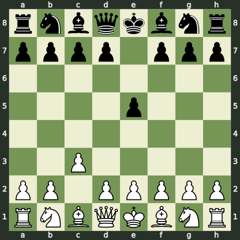

<!-- GitHub profile README for github.com/PurpleCowD -->

  <h1>Simón Paipa</h1>
  
<em>Turning ideas into software people can use.</em>

  
<a href="https://github.com/PurpleCowD/PurpleCowD/blob/main/assets/simon-paipa-cv.pdf">View my CV ↗</a>

---

## About me

I build software that connects algorithms with usable interfaces. My collaborative projects include implementing graph-search algorithms in Python, developing perception-based decision logic for an intelligent agent, and integrating Spanish speech recognition into a browser-based 3D game.

I have also designed interactive interfaces for visualizing neural-network training and developed the frontend of a tournament platform used in live competition. I enjoy making complex behavior easier to explore, understand, and use.

## Technologies & tools

### Primary stack

  

Python · TypeScript · React · Next.js · Supabase · Vercel

### Other tools I use

  

JavaScript · HTML5 · CSS3 · Tailwind CSS · Git · GitHub · VS Code

## Your move.

One board. Everyone plays. Make a move and leave the next one to another visitor.

<!-- CHESS:START -->
**Game 1 · White to move**

<table>
<tr>
<td valign="top" width="60%">

</td>
<td valign="top" width="40%">
<h3>Choose your move</h3>

Select a destination, then submit the prefilled issue. Anyone with a GitHub account can play either side.

<table>
<tr><th>From</th><th>Move</th></tr>
<tr><td>a2</td><td><a href="https://github.com/PurpleCowD/PurpleCowD/issues/new?title=chess%3A+1%3A0%3Aa2a3&amp;body=Submit+this+issue+to+play+your+move.+The+board+updates+automatically%3B+refresh+the+profile+afterwards.">a3</a> · <a href="https://github.com/PurpleCowD/PurpleCowD/issues/new?title=chess%3A+1%3A0%3Aa2a4&amp;body=Submit+this+issue+to+play+your+move.+The+board+updates+automatically%3B+refresh+the+profile+afterwards.">a4</a></td></tr>
<tr><td>b1</td><td><a href="https://github.com/PurpleCowD/PurpleCowD/issues/new?title=chess%3A+1%3A0%3Ab1a3&amp;body=Submit+this+issue+to+play+your+move.+The+board+updates+automatically%3B+refresh+the+profile+afterwards.">Na3</a> · <a href="https://github.com/PurpleCowD/PurpleCowD/issues/new?title=chess%3A+1%3A0%3Ab1c3&amp;body=Submit+this+issue+to+play+your+move.+The+board+updates+automatically%3B+refresh+the+profile+afterwards.">Nc3</a></td></tr>
<tr><td>b2</td><td><a href="https://github.com/PurpleCowD/PurpleCowD/issues/new?title=chess%3A+1%3A0%3Ab2b3&amp;body=Submit+this+issue+to+play+your+move.+The+board+updates+automatically%3B+refresh+the+profile+afterwards.">b3</a> · <a href="https://github.com/PurpleCowD/PurpleCowD/issues/new?title=chess%3A+1%3A0%3Ab2b4&amp;body=Submit+this+issue+to+play+your+move.+The+board+updates+automatically%3B+refresh+the+profile+afterwards.">b4</a></td></tr>
<tr><td>c2</td><td><a href="https://github.com/PurpleCowD/PurpleCowD/issues/new?title=chess%3A+1%3A0%3Ac2c3&amp;body=Submit+this+issue+to+play+your+move.+The+board+updates+automatically%3B+refresh+the+profile+afterwards.">c3</a> · <a href="https://github.com/PurpleCowD/PurpleCowD/issues/new?title=chess%3A+1%3A0%3Ac2c4&amp;body=Submit+this+issue+to+play+your+move.+The+board+updates+automatically%3B+refresh+the+profile+afterwards.">c4</a></td></tr>
<tr><td>d2</td><td><a href="https://github.com/PurpleCowD/PurpleCowD/issues/new?title=chess%3A+1%3A0%3Ad2d3&amp;body=Submit+this+issue+to+play+your+move.+The+board+updates+automatically%3B+refresh+the+profile+afterwards.">d3</a> · <a href="https://github.com/PurpleCowD/PurpleCowD/issues/new?title=chess%3A+1%3A0%3Ad2d4&amp;body=Submit+this+issue+to+play+your+move.+The+board+updates+automatically%3B+refresh+the+profile+afterwards.">d4</a></td></tr>
<tr><td>e2</td><td><a href="https://github.com/PurpleCowD/PurpleCowD/issues/new?title=chess%3A+1%3A0%3Ae2e3&amp;body=Submit+this+issue+to+play+your+move.+The+board+updates+automatically%3B+refresh+the+profile+afterwards.">e3</a> · <a href="https://github.com/PurpleCowD/PurpleCowD/issues/new?title=chess%3A+1%3A0%3Ae2e4&amp;body=Submit+this+issue+to+play+your+move.+The+board+updates+automatically%3B+refresh+the+profile+afterwards.">e4</a></td></tr>
<tr><td>f2</td><td><a href="https://github.com/PurpleCowD/PurpleCowD/issues/new?title=chess%3A+1%3A0%3Af2f3&amp;body=Submit+this+issue+to+play+your+move.+The+board+updates+automatically%3B+refresh+the+profile+afterwards.">f3</a> · <a href="https://github.com/PurpleCowD/PurpleCowD/issues/new?title=chess%3A+1%3A0%3Af2f4&amp;body=Submit+this+issue+to+play+your+move.+The+board+updates+automatically%3B+refresh+the+profile+afterwards.">f4</a></td></tr>
<tr><td>g1</td><td><a href="https://github.com/PurpleCowD/PurpleCowD/issues/new?title=chess%3A+1%3A0%3Ag1f3&amp;body=Submit+this+issue+to+play+your+move.+The+board+updates+automatically%3B+refresh+the+profile+afterwards.">Nf3</a> · <a href="https://github.com/PurpleCowD/PurpleCowD/issues/new?title=chess%3A+1%3A0%3Ag1h3&amp;body=Submit+this+issue+to+play+your+move.+The+board+updates+automatically%3B+refresh+the+profile+afterwards.">Nh3</a></td></tr>
<tr><td>g2</td><td><a href="https://github.com/PurpleCowD/PurpleCowD/issues/new?title=chess%3A+1%3A0%3Ag2g3&amp;body=Submit+this+issue+to+play+your+move.+The+board+updates+automatically%3B+refresh+the+profile+afterwards.">g3</a> · <a href="https://github.com/PurpleCowD/PurpleCowD/issues/new?title=chess%3A+1%3A0%3Ag2g4&amp;body=Submit+this+issue+to+play+your+move.+The+board+updates+automatically%3B+refresh+the+profile+afterwards.">g4</a></td></tr>
<tr><td>h2</td><td><a href="https://github.com/PurpleCowD/PurpleCowD/issues/new?title=chess%3A+1%3A0%3Ah2h3&amp;body=Submit+this+issue+to+play+your+move.+The+board+updates+automatically%3B+refresh+the+profile+afterwards.">h3</a> · <a href="https://github.com/PurpleCowD/PurpleCowD/issues/new?title=chess%3A+1%3A0%3Ah2h4&amp;body=Submit+this+issue+to+play+your+move.+The+board+updates+automatically%3B+refresh+the+profile+afterwards.">h4</a></td></tr>
</table>
</td>
</tr>
</table>
<!-- CHESS:END -->

Inspired by [Tim Burgan’s community chess](https://github.com/timburgan/timburgan). Rules validated with [python-chess](https://python-chess.readthedocs.io/).

---

  
<em>Thanks for stopping by—and for making your move.</em>

  © 2026 Simón Paipa. Original profile content.

